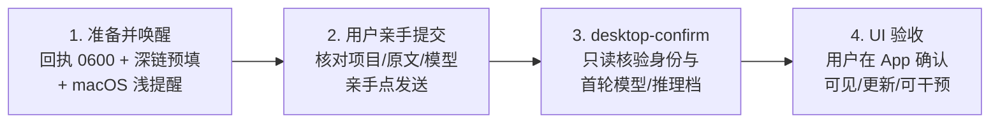

# codex-bridge（codex通信）

> 让 AI 派活给 AI，但扳机永远在人手里。


*A bridge between WorkBuddy and the Codex desktop app: dispatch tasks, verify identities read-only, watch rollouts live, and accept results — with the human always holding the final trigger.*

---

## 这个项目是怎么来的

我在用 [WorkBuddy](https://www.workbuddy.cn) 干活时，想把重活派给本机的 Codex 桌面 App 执行。听上去就是一行 `open` 命令的事，实际连踩了三个坑——每个坑的共同点：**看起来成功了，其实什么都没发生**。

### 坑一：`open` 返回 0 ≠ 任务派出去了

`open codex://new?path=...&prompt=...` 退出码 0，只代表 macOS **接受了这个 URL 请求**。任务出现在 App 里了吗？预填对了吗？不知道。就像把信扔进邮筒——邮筒不会告诉你信送到了没有。

### 坑二：绕过界面走 daemon，结果两个后端各写各的

那就绕过 GUI，直接连 app-server daemon 建任务呗？建是建成了，再拿 deep link 打开——App 报"**已在另一个应用中打开**"。挖到源码层才发现：桌面 App 自己启动一个 stdio 后端，managed daemon 是另一个进程，两者**共用磁盘上的 SQLite，但不共用 writer**。共享存储 ≠ 共享所有权。

### 坑三：数据库有记录 ≠ 界面可见、可干预

就算在 `state_5.sqlite` 里查到了任务行，也只能证明"数据库里有这么一行"，证明不了界面真的出现了、过程在更新、用户能插手。

### 以及一个贯穿始终的老毛病

AI 会**假报完成**：prepare 成功就说"已派出"，超时就猜"应该跑完了"。自动化越顺，撒谎越不动声色。

## 所以这个桥长这样

踩完坑之后的所有设计，都围绕一句话：**凡是不能核验的，宁可报 unknown，不报 success。**

1. **发射闸**：AI 只做准备（回执、预填、提醒）和只读核验，**点击发送的恒为人**。桥没有、也不要 GUI 自动化能力
2. **观测诚实**：`open` 返回 0、数据库有记录、准备命令退出 0——都不算派单成功。任务死没死？不知道就说不知道
3. **一切可对账**：派单前先建 git 基线，收单 `git diff <基线>..<结果>` 就是天然验收清单；watch 断点锚点绑定 thread_id + inode + sha256 前缀，源文件被替换立刻报 `source_changed`，绝不套旧锚点猜
4. **零网络外发**：仅本机 Unix socket / stdio 子进程 / `codex://` 深链，纯 Python 标准库，无第三方依赖

## 工作流：四步敲锣



`open` 返回 0、回执落盘、数据库有记录——**都不算完整派单成功**。第 4 步必须是人实际看到界面。

## 三分钟上手

前置条件：macOS + Codex 桌面 App + Python 3.9+（零第三方依赖）。

```bash
# 1. 拷进 WorkBuddy skills 目录
cp -r codex-bridge ~/.workbuddy/skills/

# 2. 派单（默认 desktop 敲锣模式）
B=~/.workbuddy/skills/codex-bridge/scripts/codex_bridge.py
python3 "$B" dispatch --name "重构支付模块" --task "读取 REQUEST.md 并执行…"
# → App 弹出预填草稿，你核对后亲手点发送

# 3. 确认身份（只读）
python3 "$B" desktop-confirm <dispatch 返回的 receipt_path>

# 4. 长任务直播（只读尾随，可断点续播）
python3 "$B" watch <THREAD_ID> --follow --turn-id <TURN_ID>

# 5. 收单：只读历史 + git diff 对账
python3 "$B" read <THREAD_ID>
```

## 命令速查

| 命令                    | 干什么                                               | 退出码语义                       |
| --------------------- | ------------------------------------------------- | --------------------------- |
| `dispatch`            | 默认请求 App 原生草稿（敲锣）；`--transport daemon/stdio` 显式后台 | 0=准备成功，未确认派出                |
| `desktop-confirm`     | 只读核验新任务身份、原文、首轮模型                                 | 0=身份确认；3=待提交；2=不匹配          |
| `watch`               | 只读尾随 rollout，锚点续播                                 | 0=completed；3=超时/源变=unknown |
| `read` / `status`     | 只读历史 / 状态                                         | 0=读取成功                      |
| `steer` / `interrupt` | 后台会话纠偏/急停（必须显式 `--transport`）                     | 0=请求已接受                     |

后台模式（daemon/stdio）仅显式选择，且**拒绝操作桌面 App 的任务**——writer 归属分不清就停下来，不猜。

## 配置

| 配置项                       | 默认                                             |
| ------------------------- | ---------------------------------------------- |
| 模型                        | `--model` > `config.json.default_model` > 内置兜底 |
| `CODEX_BRIDGE_CODEX_BIN`  | `PATH` 查找 → `~/.local/bin/codex`               |
| `CODEX_BRIDGE_CWD`        | 派单锚定的项目目录（默认用户主目录）                             |
| `CODEX_BRIDGE_CODEX_HOME` | `~/.codex`                                     |
| `CODEX_BRIDGE_STATE_DIR`  | 回执目录，默认 `~/.workbuddy/codex-bridge/dispatch`   |

## 安全设计

- 回执 0600 权限、拒绝符号链接、rollout 路径围栏（不许逃出会话目录）
- SQLite 只读打开（`mode=ro` + `PRAGMA query_only`）
- macOS 通知走 osascript **argv 传参**，不做脚本字面量拼接（注入免谈）
- 密钥红线：桥只传任务文本，凭据永远留在本机原位置

## 测试

```bash
python3 -m pytest tests/ -q   # 105 项
```

## 边界（丑话说前头）

- 仅 macOS（深链 + osascript + `open`）
- `codex://new` 的 `mode=codex` 是未公开参数（本机实证可用）；失效时移除它，官方参数 `path`/`prompt` 仍成立
- 桥保证观测诚实，**不保证任务不死**：App 崩溃、系统休眠、模型限流均无兜底
- Codex 内部存储格式升级时，桥会报 schema 校验错误并拒绝硬跑——这是在保护你

## License

[MIT](LICENSE)
